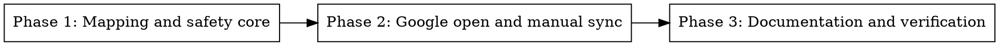

# Plan: Open in Google Workspace

> **Source:** [design](../2026-10-24-open-in-google-workspace-design.md)
> **Created:** 2026-10-24
> **Status:** complete

## Goal

Deliver a safe, standalone cross-platform launcher that maps local Office files to one
Google Workspace copy and explicitly pulls remote changes back.

## Acceptance Criteria

- [ ] Supported CSV, Excel, Word, and PowerPoint files import once and reopen by Drive ID.
- [ ] A manual sync exports remote changes atomically when the local baseline is unchanged.
- [ ] Sync refuses to overwrite a locally changed file.
- [ ] OAuth setup, limits, and OS association guidance are documented.
- [ ] Behavioral tests pass without live Google credentials.

## Codebase Context

### Existing Patterns to Follow

- **Standalone Python tool:** `video-lens/video-lens.py` — executable `uv run` script with
  PEP 723 metadata and a sibling prompt log.
- **Local state:** `pin/pin.py` — SQLite-backed command-line state.

### Test Infrastructure

There is no repository-wide Python test configuration. This tool adds a focused `unittest`
suite next to its script, runnable through `uv run`.

## Phase Graph

